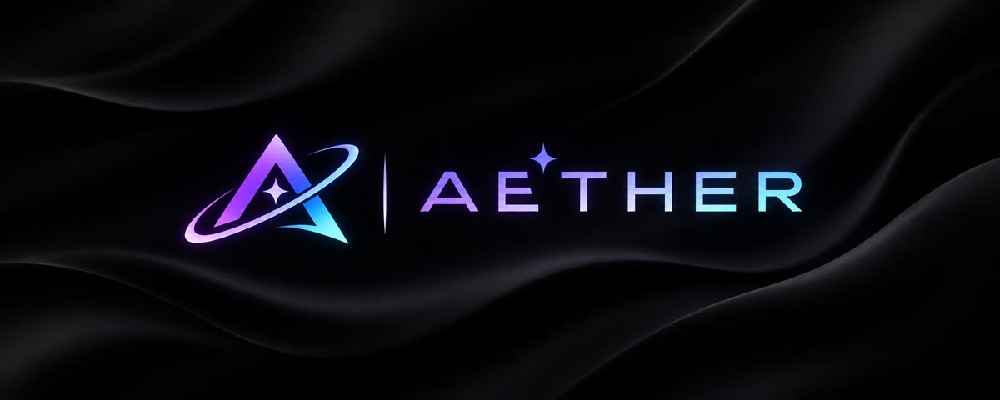

<p align="center">
  
</p>

<p align="center">
  <br>
  <b>Linux rices on Windows, yeah</b><br>
  Real Quickshell desktop shells plus a Hyprland-style tiling window manager, running natively on Windows.
</p>

<p align="center">
  <a href="https://github.com/crszy/aether/releases/latest"></a>
  <a href="https://discord.gg/hGdR8GHPEM"></a>
  
</p>

---

## Install

1. Download **AetherSetup.exe** from the [latest release](https://github.com/crszy/aether/releases/latest)
   (or `Aether-portable.zip` if you don't want an installer).
2. Run it. Everything Aether replaces is backed up, and uninstalling puts it back.
3. Open the launcher (`Super`, then type) and type `>aether` for Settings.

Questions, rices to share, bugs: **[join the Discord](https://discord.gg/hGdR8GHPEM)**.

## Showcase

<!-- Clips go in docs/media/ (GIF or MP4, recorded on a neutral wallpaper). -->

| Shells | AetherWM tiling |
| --- | --- |
| *Caelestia, end-4, DMS, Noctalia, Ryoku and Zenith, mixed and matched* | *Open at the mouse, Hyprland-style open/close/move animations* |

## What you get

- **Real Linux shells.** Caelestia (Aether's own shell), end-4's illogical-impulse, DankMaterialShell, Noctalia, Ryoku
  and Zenith: their bars, docks, launchers, lock screens, OSDs, notifications and desktop widgets, ported to Windows.
- **Mix & match.** Take each part from a different shell: a DMS bar, a Noctalia dock, a Caelestia launcher, a Ryoku
  lock screen...
- **AetherWM.** Tiling that reads Hyprland's own config (`~/.config/hypr/hyprland.conf`): keybinds, gaps, borders,
  workspaces, window rules and animations (`windowsIn`, `windowsOut`, `windowsMove`, popin/slide/fade/genie). New
  windows open where your mouse is. There is also a niri-style scrolling mode (`aetherwm mode niri`).
- **AetherStore.** Paste any Linux dotfiles repo and Aether picks out what works on Windows: Hyprland configs,
  kitty/foot/Alacritty themes as Windows Terminal profiles, fastfetch, Starship, Zen/Firefox themes, Hyprlock lock
  screens, wallpapers and whole Quickshell shells.
- **One settings center.** `>aether` opens Aether Settings from any shell.
- **Your own pieces.** Drop a QML file into `~/.config/caelestia/user` and it becomes a widget, panel, lock screen,
  dashboard tab or mod, reloaded live. Any `~/.config/quickshell/<name>` config runs like `qs -c <name>` on Linux.

## AetherWM from a terminal

```
aetherwm status
aetherwm start --hyprland      # or --niri, --infinitedesk
aetherwm reload                # after editing hyprland.conf
aetherwm stop
```

## In this repo

| Folder | What it is |
| --- | --- |
| `shell/` | Aether's Quickshell config: Caelestia for Windows, the ported shells, Aether Settings, the store engine |
| `engine/` | The Windows build of Quickshell that runs it all (fork of quickshell-windows) |
| `aetherwm/` | AetherWM, the tiling window manager (Rust) |
| `launcher/` | Starts, syncs and watches the shell |
| `cli/` | The command-line tool |
| `ryoku/` | The Ryoku port |
| `ports/` | Scripts and overrides that port each Linux shell |
| `store/` | AetherStore lists and previews |
| `installer/` | The installer |
| `tools/` | Small helpers |

Building needs Visual Studio 2022 (C++), Qt 6, Rust (GNU toolchain) and Go; the scripts in `ports/`, `installer/`
and `engine/` show the steps.

## Credits

Aether stands on these projects, go support them:
[Quickshell](https://github.com/outfoxxed/quickshell) ·
[quickshell-windows](https://github.com/nunreasonable/quickshell-windows) ·
[Caelestia](https://github.com/caelestia-dots/shell) ·
[end-4 / dots-hyprland](https://github.com/end-4/dots-hyprland) ·
[DankMaterialShell](https://github.com/AvengeMedia/DankMaterialShell) ·
[Noctalia](https://github.com/noctalia-dev/noctalia-shell) ·
[Ryoku](https://github.com/Ryoku-dev/ryoku) ·
[Zenith](https://github.com/zaeemali272/zenith-shell) ·
[Hyprland](https://github.com/hyprwm/Hyprland) ·
[komorebi](https://github.com/LGUG2Z/komorebi) by LGUG2Z, which AetherWM began as a fork of
(via [cipheroute's fork](https://github.com/cipheroute/komorebi)).

Licences: see [THIRD-PARTY.md](THIRD-PARTY.md).

## Licence

AGPL-3.0-or-later (`LICENSE`; the GPL-3.0 text it builds on is kept as `LICENSE-GPL-3.0`), except `aetherwm/` (Komorebi License 2.0.0, personal non-commercial use, see
`aetherwm/LICENSE.md`), `engine/` (LGPL-3.0, like Quickshell), and ported code, which keeps its own licence (DMS and
Noctalia MIT, DarkShadowShell MIT, serpantinum AGPL-3.0, Zenith public domain, `tools/m3shapes` Apache-2.0).

The old native ImGui Aether (v1.x) is on the [`native-v1`](https://github.com/crszy/aether/tree/native-v1) branch.
